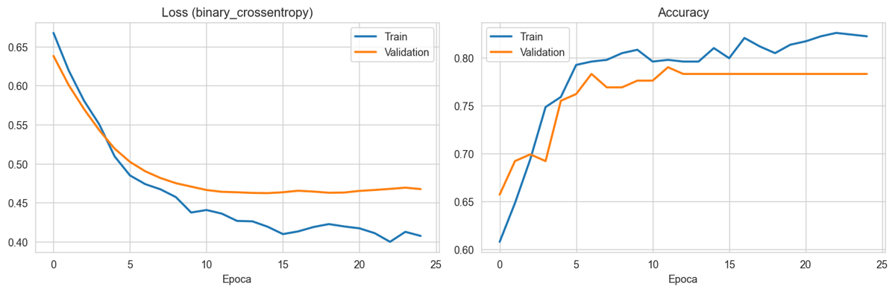
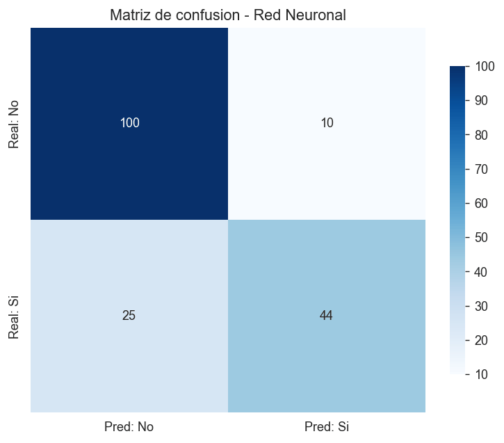
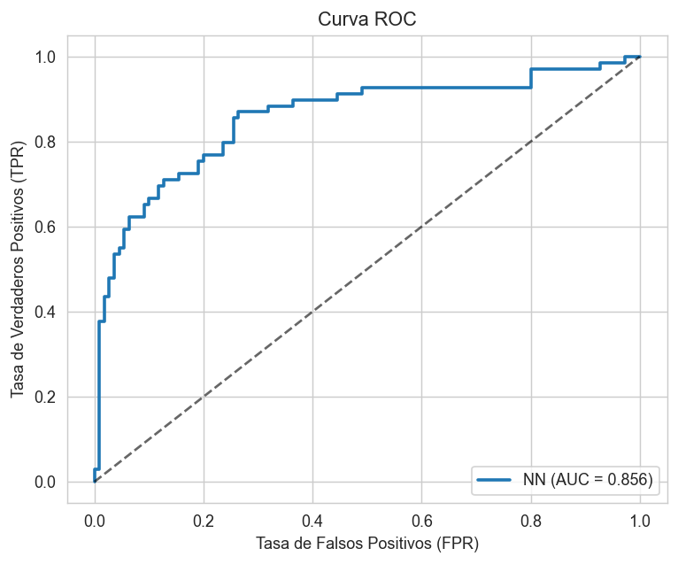

# Proyectos de la universidad

Selección de proyectos de la carrera en la **Universidad de Guadalajara (UDG)**.

> 📚 Resumen de cada proyecto; el código y los reportes se entregaron en el aula virtual de cada materia.

## Compiladores — IDE y compilador propio
Compilador construido por módulos a lo largo del semestre, con **IDE de escritorio en Python**:
- **Análisis léxico**, **sintáctico** y **semántico**, con tabla de símbolos y mensajes de error.
- Estructuras de control: `if`, `switch`, `for`, ciclos anidados.
- **Intérprete integrado** que ejecuta programas de prueba (por ejemplo, ordenamiento burbuja).
- IDE con resaltado, búsqueda, deshacer y pestañas por fase del compilador.
- Implementación del "Lenguaje M" de la materia (tokens de una sola letra: M=main, R=read, W=write).
- Las entregas se generan automáticamente a partir del compilador acumulado.

## Administración de Redes — laboratorios Cisco (CCNA 2)
Prácticas en Packet Tracer: **VLANs y enrutamiento entre VLANs**, **EtherChannel**, **DHCPv4/DHCPv6** y diseño de red de un centro de datos.
- Script en Python que **genera los reportes** a partir de las plantillas de Cisco: llena los comandos de configuración y agrega la portada.
- Lectura de archivos `.pka/.pkt` sin abrir Packet Tracer (descifrado del formato) para revisar las configuraciones.

## Inteligencia Artificial — red neuronal para el Titanic
Red neuronal que predice la supervivencia de los pasajeros del Titanic (Kaggle): análisis exploratorio, preprocesamiento, entrenamiento y evaluación con matriz de confusión y curva ROC. También se hizo una práctica de **algoritmos genéticos** y validación de modelos.

| Entrenamiento | Matriz de confusión | Curva ROC |
|---|---|---|
|  |  |  |

## Teoría de la Computación — autómatas
Máquina expendedora modelada como **autómata finito** en JFLAP (versión simple y completa).
